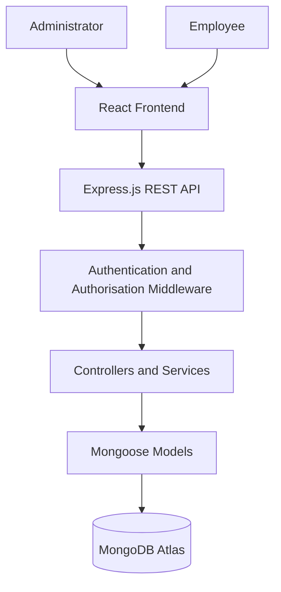

# AssetGuard
### Secure Web-Based Asset Management System for Small and Medium-Sized Enterprises (SMEs)

**AssetGuard** is a secure web-based asset management application developed to help Small and Medium-Sized Enterprises (SMEs) manage organisational assets while strengthening user authentication, access control and accountability.

The application integrates multi-factor authentication (MFA), role-based access control (RBAC), secure password handling and activity logging to provide a centralised platform for managing organisational assets.

---

## Table of Contents

1. [Project Overview](#1-project-overview)
2. [Project Objectives](#2-project-objectives)
3. [Key Features](#3-key-features)
4. [Technology Stack](#4-technology-stack)
5. [System Architecture](#5-system-architecture)
6. [Project Structure](#6-project-structure)
7. [Security Implementation](#7-security-implementation)
8. [Installation and Setup](#8-installation-and-setup)
9. [Environment Configuration](#9-environment-configuration)
10. [Running the Application](#10-running-the-application)
11. [API Testing](#11-api-testing)
12. [Testing and Code Quality](#12-testing-and-code-quality)
13. [Limitations and Future Improvements](#13-limitations-and-future-improvements)
14. [Project Context](#14-project-context)
15. [Author](#15-author)

---

## 1. Project Overview

Small and Medium-Sized Enterprises increasingly depend on digital technologies to manage business operations and organisational resources. However, inadequate authentication mechanisms and insufficient access restrictions can expose business information and assets to unauthorised access.

AssetGuard addresses these challenges through a web-based platform that combines secure user authentication with organisational asset management.

The system provides two primary user roles:

- **Administrator:** Responsible for managing users, organisational assets, asset assignments and reviewing recorded system activities.
- **Employee:** Accesses an employee workspace and views assets assigned to their account.

By combining authentication, authorisation and asset management functionality, AssetGuard demonstrates how security mechanisms can be incorporated into a practical SME-oriented web application.

## 2. Project Objectives

The project was developed with the following objectives:

- To implement a secure web-based asset management application for SMEs.
- To strengthen user authentication through multi-factor authentication.
- To protect user credentials through secure password hashing.
- To enforce role-based access restrictions.
- To provide functionality for creating, updating, assigning and managing organisational assets.
- To improve accountability through activity logging.
- To provide employees with access to their assigned organisational assets.

## 3. Key Features

### 3.1 Authentication and Account Security

- User registration and email OTP verification.
- Multi-factor authentication during login.
- Password hashing using bcrypt.
- JWT-based authentication using HTTP-only session cookies.
- Password recovery through OTP verification.
- OTP expiration and verification attempt controls.
- Registration OTP resend functionality.

### 3.2 Asset Management

- Create, view, update and delete organisational assets.
- Assign assets to active employees.
- Unassign assets and update asset availability.
- View assigned assets through the employee workspace.
- Manage asset information, including names, categories and serial numbers.

### 3.3 User Management and Access Control

- Administrator and employee roles.
- Role-based authorisation enforced through backend middleware.
- Protected application routes.
- Administrator-only user management functionality.
- Employee access restricted to permitted resources.

### 3.4 Audit Logging

- Recording of selected sensitive system activities.
- Tracking of actions such as asset creation, assignment, unassignment and deletion.
- Association of recorded activities with the responsible user.
- Administrator-only access to audit log records.

### 3.5 User Interface

- Role-specific dashboards and navigation.
- Dedicated authentication and password recovery interfaces.
- Administrator asset and user management interfaces.
- Employee workspace for viewing assigned assets.
- Responsive web interface.

## 4. Technology Stack

| Component | Technology |
|---|---|
| Frontend | React |
| Build Tool | Vite |
| Backend Runtime | Node.js |
| Backend Framework | Express.js |
| Database | MongoDB Atlas |
| Object Data Modelling | Mongoose |
| Authentication | JSON Web Tokens (JWT) |
| Password Security | bcrypt |
| API Testing | Postman and cURL |
| Code Quality | ESLint |
| Version Control | Git and GitHub |

## 5. System Architecture

AssetGuard follows a layered client-server architecture consisting of three main tiers.

### 5.1 Presentation Tier

The presentation tier is implemented using React and Vite. It provides the user interface through which administrators and employees interact with the application.

### 5.2 Application Tier

The application tier is implemented using Node.js and Express.js. It handles API requests, authentication, authorisation, validation, business logic and communication with the database.

### 5.3 Data Tier

The data tier uses MongoDB Atlas with Mongoose for data modelling and database operations. It stores application information, including user accounts, assets, OTP verification records and audit logs.

### Architecture Overview



The separation of presentation, application processing and data management supports modularity, maintainability and structured access control.

## 6. Project Structure

The repository is organised into separate frontend, backend, documentation and API testing components.

```text
secure-authentication-system/
│
├── .postman/
│   └── resources.yaml
│
├── backend/
│   ├── src/
│   │   ├── config/
│   │   │   └── db.js
│   │   │
│   │   ├── controllers/
│   │   │   ├── assetController.js
│   │   │   ├── auditLogController.js
│   │   │   ├── authController.js
│   │   │   └── userController.js
│   │   │
│   │   ├── middleware/
│   │   │   └── authMiddleware.js
│   │   │
│   │   ├── models/
│   │   │   ├── Asset.js
│   │   │   ├── AuditLog.js
│   │   │   ├── OtpVerification.js
│   │   │   └── User.js
│   │   │
│   │   ├── routes/
│   │   │   ├── assetRoutes.js
│   │   │   ├── auditLogRoutes.js
│   │   │   ├── authRoutes.js
│   │   │   └── userRoutes.js
│   │   │
│   │   ├── services/
│   │   │   ├── emailService.js
│   │   │   └── otpService.js
│   │   │
│   │   ├── utils/
│   │   │   ├── auditLogger.js
│   │   │   └── otp.js
│   │   │
│   │   ├── validators/
│   │   │   ├── assetValidator.js
│   │   │   └── authValidator.js
│   │   │
│   │   ├── app.js
│   │   └── server.js
│   │
│   ├── tests/
│   ├── package.json
│   └── package-lock.json
│
├── docs/
│   └── testing/
│
├── frontend/
│   ├── public/
│   ├── src/
│   │   ├── assets/
│   │   ├── components/
│   │   │   ├── auth/
│   │   │   ├── dashboard/
│   │   │   ├── landing/
│   │   │   ├── layout/
│   │   │   └── ui/
│   │   │
│   │   ├── context/
│   │   ├── hooks/
│   │   │
│   │   ├── pages/
│   │   │   ├── admin/
│   │   │   ├── auth/
│   │   │   ├── employee/
│   │   │   ├── public/
│   │   │   └── shared/
│   │   │
│   │   ├── services/
│   │   ├── utils/
│   │   ├── App.jsx
│   │   ├── App.css
│   │   ├── index.css
│   │   └── main.jsx
│   │
│   ├── package.json
│   ├── vite.config.js
│   └── eslint.config.js
│
├── postman/
│   ├── collections/
│   │   └── AssetGuard API Testing Requests.postman_collection.json
│   │
│   ├── documents/
│   ├── environments/
│   │   └── AssetGuard Local Environment.postman_environment.json
│   │
│   ├── flows/
│   ├── globals/
│   │   └── workspace.globals.yaml
│   │
│   ├── mocks/
│   └── specs/
│
├── .gitignore
└── README.md
```

*Environment files, session cookie files, installed dependencies and generated build output are intentionally excluded from this documented structure.*

## 7. Security Implementation

Security is incorporated into the application's authentication, authorisation and data-handling processes.

| Security Mechanism | Implementation |
|---|---|
| Multi-Factor Authentication | Email-based OTP verification |
| Password Protection | bcrypt password hashing |
| Session Authentication | JWT stored in HTTP-only cookies |
| Role-Based Access Control | Backend authorisation middleware |
| OTP Security | Expiration, attempt controls and usage tracking |
| Route Protection | Authentication and role verification |
| Accountability | Audit logging of selected system activities |

Backend authorisation provides the primary access-control enforcement, while frontend route protection supports the user experience.

## 8. Installation and Setup

### 8.1 Prerequisites

Ensure that the following tools and services are available:

- [Node.js](https://nodejs.org/)
- npm (included with Node.js)
- [Git](https://git-scm.com/)
- [MongoDB Atlas](https://www.mongodb.com/atlas) account or an accessible MongoDB instance
- [Postman](https://www.postman.com/) (optional, for API testing)

### 8.2 Clone the Repository

Clone the project from GitHub:

```bash
git clone https://github.com/BennyKT2001/secure-authentication-system.git
```

Navigate into the project directory:

```bash
cd secure-authentication-system
```

### 8.3 Configure the Backend

Navigate to the backend directory:

```bash
cd backend
```

Install the backend dependencies:

```bash
npm install
```

Create a `.env` file inside the `backend` directory and configure the required environment variables.

The required variables are described in [Environment Configuration](#9-environment-configuration).

### 8.4 Configure the Frontend

Open a second terminal from the project root and navigate to the frontend directory:

```bash
cd frontend
```

Install the frontend dependencies:

```bash
npm install
```

Create a `.env` file inside the `frontend` directory containing:

```env
VITE_API_URL=http://localhost:3000/api
```

## 9. Environment Configuration

The application uses environment variables to keep configuration values and sensitive credentials outside the source code.

### 9.1 Backend Environment Variables

Create `backend/.env`:

```env
MONGO_URI=your_mongodb_connection_string
JWT_SECRET=your_secure_jwt_secret
JWT_EXPIRES_IN=your_jwt_expiration
CLIENT_URL=http://localhost:5173

MAIL_HOST=your_smtp_host
MAIL_PORT=your_smtp_port
MAIL_USER=your_smtp_username
MAIL_PASSWORD=your_smtp_password
```

Replace the example values with your actual configuration.

### 9.2 Frontend Environment Variables

Create `frontend/.env`:

```env
VITE_API_URL=http://localhost:3000/api
```

### Important Security Note

- Never commit `.env` files to GitHub.
- Never publish database credentials, SMTP passwords, JWT secrets, OTP values or authentication cookies.
- Use your own credentials and configuration when setting up the application.
- Only publish example configuration files containing placeholder values.

## 10. Running the Application

The backend and frontend must run simultaneously during local development.

### 10.1 Start the Backend

From the `backend` directory:

```bash
npm run dev
```

The backend development server runs at:

```text
http://localhost:3000
```

### 10.2 Start the Frontend

From the `frontend` directory:

```bash
npm run dev
```

The frontend development server runs at:

```text
http://localhost:5173
```

### 10.3 Access AssetGuard

Open a browser and navigate to:

```text
http://localhost:5173
```

Ensure that both development servers are running and that the database connection and email configuration are valid.

## 11. API Testing

The backend API was tested using Postman and cURL.

The repository includes an exported Postman collection containing 17 API requests and a corresponding local environment configuration.

### 11.1 Postman Collection

The collection is located at:

```text
postman/collections/
```

File:

```text
AssetGuard API Testing Requests.postman_collection.json
```

### 11.2 Postman Environment

The environment configuration is located at:

```text
postman/environments/
```

File:

```text
AssetGuard Local Environment.postman_environment.json
```

The environment uses the following base URL variable:

```text
{{baseUrl}}
```

Its local development value is:

```text
http://localhost:3000/api
```

### 11.3 Importing the Collection

To reproduce the API tests:

1. Open Postman.
2. Select **Import**.
3. Import the exported collection from `postman/collections/`.
4. Import the environment from `postman/environments/`.
5. Select **AssetGuard Local Environment**.
6. Verify that the `baseUrl` variable points to the running backend.
7. Execute the individual requests to test the available API functionality.

The collection covers authentication, OTP verification, password recovery, asset management, employee asset access and role-based authorisation.

## 12. Testing and Code Quality

The application underwent functional, integration, security and interface testing.

### 12.1 Functional and Security Testing

Testing covered:

- User registration and OTP verification.
- Login and multi-factor authentication.
- Expired and previously used OTP rejection.
- Password recovery and reset.
- Asset creation, assignment, unassignment and deletion.
- Employee access to assigned assets.
- Administrator and employee authorisation restrictions.
- Administrator access to audit logs.
- Role-specific application interfaces.

### 12.2 Evaluation Results

The final documented test set contained 16 test cases.

| Evaluation Metric | Result |
|---|---:|
| Total test cases | 16 |
| Passed test cases | 16 |
| Failed test cases | 0 |
| Final test pass rate | 100% |
| Frontend lint verification | Passed |
| Frontend production build | Passed |

The reported 100% pass rate applies to the documented test cases executed during prototype validation. It does not represent independent security certification or production-readiness certification.

### 12.3 Code Quality Verification

ESLint was used to check frontend code quality.

Run the following command from the frontend directory:

```bash
npm run lint
```

The frontend production build can be generated using:

```bash
npm run build
```

Both commands completed successfully during implementation verification.

## 13. Limitations and Future Improvements

Although AssetGuard successfully implements its core objectives within the prototype scope, several improvements could be considered in future development.

Potential improvements include:

- Formal penetration testing and independent security assessment.
- Automated backend unit and integration testing.
- Performance and load testing.
- Advanced audit log filtering and pagination.
- Improved audit log archival and integrity protection.
- Production deployment and monitoring.
- Additional security and operational controls for real SME environments.

## 14. Project Context

AssetGuard was developed as a postgraduate capstone project focused on secure web-based authentication, access control and asset management for Small and Medium-Sized Enterprises.

The project demonstrates the integration of authentication and authorisation mechanisms into a practical web-based asset management application.

## 15. Author

**Developed by:** Benedict Kitwa

**Project Title:** Secure Web-Based Asset Management System for Small and Medium-Sized Enterprises (SMEs)

**Academic Programme:** Postgraduate Diploma

**GitHub Repository:** [secure-authentication-system](https://github.com/BennyKT2001/secure-authentication-system)

---

**AssetGuard — Secure Access. Accountable Asset Management.**